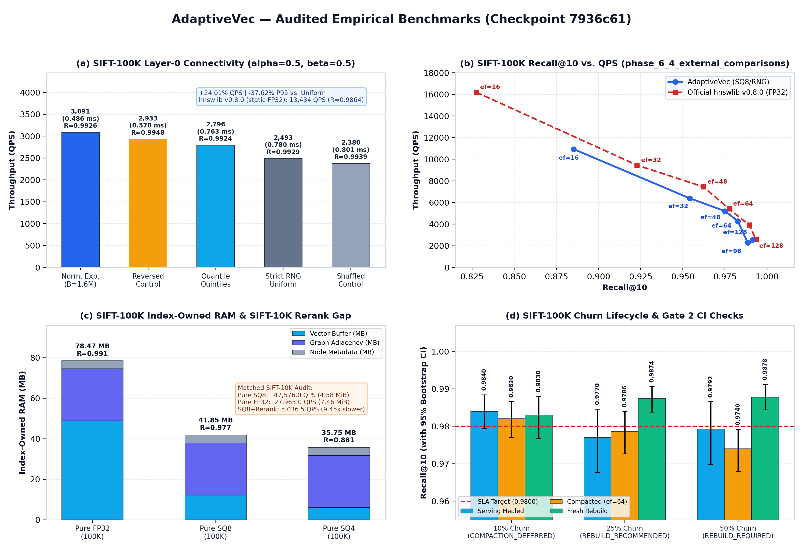
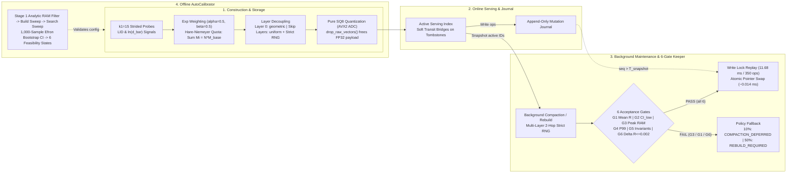

<div align="center">

# AdaptiveVec

### Geometry-Aware and Resource-Constrained Approximate Nearest Neighbor Search with Dynamic Graph Maintenance

[](https://python.org)
[](https://isocpp.org)
[](./tests)
[](./CMakeLists.txt)
[](./server.py)
[](./frontend-react)
[](./research/paper/evidence_map.md)

**Aradhya G. S.** • *Department of Computer Science and Engineering*  
[github.com/aradhyags7/AdaptiveVec](https://github.com/aradhyags7/AdaptiveVec) • Target Platform: Commodity x86-64 CPUs (Intel Core 5 210H, AVX2/FMA, 16 GB RAM)

</div>

---

**AdaptiveVec** is an in-memory C++17 / Python proximity-graph vector search engine built for memory- and SLA-constrained deployments. Rather than running feedback controllers inside the query hot path—which added synchronization and telemetry overhead in earlier prototypes—AdaptiveVec moves structural intelligence to graph construction, purges raw FP32 vectors after quantization, gates dynamic maintenance behind dual-residency and bootstrap checks, and verifies parameter feasibility offline.

> Every metric, confidence interval, and plot below traces directly to raw JSON artifacts in [`experiments/`](./experiments) and C++/Python sources at research checkpoint `7936c61`. See [`research/paper/evidence_map.md`](./research/paper/evidence_map.md) for the complete claim-to-artifact ledger.

---

## Audited Benchmark Overview

<p align="center">
  
  <br>
  <sub><b>Figure 1 — Audited Results (<code>7936c61</code>):</b> (a) SIFT-100K Layer-0 connectivity controls at fixed nominal forward quota <i>B</i> = 1,600,000 and weights (<i>α</i><sub>lid</sub>=0.5, <i>β</i><sub>spars</sub>=0.5) (<code>phase_6_1_geometry_reproduction.json</code>); (b) SIFT-100K Recall@10 vs. QPS sweep against official <code>hnswlib</code> v0.8.0 (<code>phase_6_4_external_comparisons.json</code>); (c) SIFT-100K fresh isolated subprocess index-owned RAM breakdown (<code>phase_6_4_fresh_precision_memory.json</code>) with matched SIFT-10K FP32 re-ranking throughput comparison (<code>phase_6_1_quantization_memory_audit.json</code>); (d) SIFT-100K dynamic churn lifecycle and Gate 2 95% bootstrap CI checks against a 0.9800 recall SLA (<code>phase_6_4_dynamic_maintenance_investigation.json</code>).</sub>
</p>

---

## System Architecture & Safe Replacement Flow



---

## Four Core Mechanisms & Verified Empirical Results

### 1. Geometry-Aware Graph Intelligence (`cpp/budget_allocator.hpp`)

- **Problem & Design:** Uniform HNSW out-degree bounds `M` over-connect low-LID interior clusters while starving dense high-LID neighborhoods, whereas unconstrained adaptive `M` in earlier prototypes expanded total edges across settings and confounded topology comparisons.
- **Implementation:** Batch construction estimates Levina–Bickel MLE LID and `sparsity = ln(max(1e-6, d_bar_i))` over `k1 = 15` strided neighbor probes (`phase6_1_evidence_runner.cpp`), standardizes both with population std (`sigma^2 >= 1e-8`) clamped to `[-3.0, +3.0]`, scores vertices with verified production defaults **`alpha_lid = 0.5, beta_spars = 0.5`** (no calibration overrides), applies Layer Decoupling (**`beta_0 = 1.0, beta_upper = 0.0`**) with Strict RNG pruning (`keep_pruned_connections = false`, removing fallback collinear edges that fired in 95.1% of heuristic calls), and discretizes target degrees via **Hare–Niemeyer largest-remainder apportionment**.
- **Conditional Quota Conservation:** Nominal assigned forward quotas sum to `N * M_base` (`1,600,000` on SIFT-100K) whenever single-pass feasibility holds (`|deficit| <= |U+-|`). AdaptiveVec explicitly separates **(a)** nominal forward quota (`1.6M`), **(b)** reserved Layer-0 slot capacity (`3.2M` for `2 * M_i` reciprocal headroom), **(c)** realized directed edges (`257,370` vs `160,000` quota on `phase_6_4_streaming_budget.json`; `12,506,570` vs `8.0M` on SIFT-500K), and **(d)** physical graph RAM (`27.50 MB` at `efC=120`; `25.70 MB` at `efC=64`).

| Configuration (SIFT-100K, `N=100K`, `D=128`, `efC=120`, `efS=64`) | Recall@10 | QPS | P95 (ms) | P99 (ms) | Dist. Evals | Fwd Quota | Max L0 Slots | Graph RAM |
| :--- | :---: | :---: | :---: | :---: | :---: | :---: | :---: | :---: |
| Strict RNG Uniform (`M=16`) | 0.9929 | 2,492.5 | 0.780 | 2.062 | 1,200.5 | 1,600,000 | 3,200,000 | 27.89 MB |
| **Normalized Exponential (`beta_0=1.0, beta_u=0.0`)** | **0.9926** | **3,091.0 (+24.01%)** | **0.486 (-37.62%)** | **1.384** | **1,169.1** | **1,600,000** | **3,200,000** | **27.50 MB** |
| Normalized Quantile (Quintiles) | 0.9924 | 2,796.4 | 0.763 | --- | 1,141.9 | 1,600,000 | 3,200,000 | 27.19 MB |
| Shuffled Degree Control (Random Permutation) | 0.9939 | 2,379.8 (-23.01%) | 0.801 | --- | 1,204.4 | 1,600,000 | 3,200,000 | --- |
| Reversed Geometry Control (`M_sparse=24, M_hub=8`) | 0.9948 (+0.22 pp) | 2,933.4 (-5.10%) | 0.570 | --- | 1,234.6 (+5.60%) | 1,600,000 | 3,200,000 | --- |
| Official `hnswlib` v0.8.0 (Static C-struct FP32)\* | 0.9864 | 13,433.8 | --- | --- | --- | 1,600,000 | 3,200,000 | ---\*\* |

<sub>*`---` indicates fields omitted in `phase_6_1_geometry_reproduction.json`. **\*\*Memory Note:** `hnswlib` packs 48.83 MB FP32 vectors inline inside `data_level0_memory_` (`64.83 MB` total index memory in `phase_6_4_external_comparisons.json`, leaving 16.00 MB non-vector residual; `18.31 MB` formula link estimate in `phase5_3_experiment_runner.cpp`). Immutable `hnswlib` outperforms AdaptiveVec on raw static FP32 throughput because it omits locks, tombstones, and dynamic maintenance structures.*</sub>

- **Scale & Cross-Dataset Bounds (`phase_5_3_cross_dataset_validation.json`):** On **SIFT-500K** (`B0=8.0M`), Normalized Exponential delivers **`+15.43%` QPS** (`12,901.6` vs `11,176.6`) and **`-42.01%` P95 latency** (`1.270` vs `2.190 ms`) at matched RAM (`178.42 MB` vs `178.53 MB`). On **Transformer-384D** (`57,893` vectors, `B0=926,288`), recall improved slightly (`0.9453` vs `0.9418`) while QPS **dropped** (`11,525.1` vs `15,982.2`) and P95 increased (`1.930` vs `1.188 ms`).

---

### 2. Pure SQ8 Asymmetric Distance Computation & Vector Purging

- **Problem & Design:** After mixed-precision per-node pooling failed (`CHG-05`, dropping Transformer recall to `18%`) and two-stage FP32 re-ranking penalized cached SIFT-10K QPS by **`9.45x`**, AdaptiveVec standardized on AVX2 uniform SQ8 ADC (`_mm256_maddubs_epi16`, `_mm256_madd_epi16`) with immediate FP32 deallocation via `drop_raw_vectors()`.

| Corpus & Mode | Vector Mem. | Graph Mem. | Metadata | Index-Owned | Process WS | Recall@10 | QPS | Source Artifact |
| :--- | :---: | :---: | :---: | :---: | :---: | :---: | :---: | :--- |
| **SIFT-100K Pure FP32** (isolated) | 48.83 MB | 25.70 MB | 3.91 MB | 78.47 MB | 93.42 MB | 0.9910 | 12,705.2 | `phase_6_4_fresh_precision_memory.json` |
| **SIFT-100K Pure SQ8 ADC** (isolated) | **12.21 MB (-75%)** | 25.70 MB | 3.91 MB | **41.85 MB (-46.7%)** | **56.70 MB (-39.3%)** | **0.9770** | **12,437.2** | `phase_6_4_fresh_precision_memory.json` |
| **SIFT-100K Pure SQ4 ADC** (isolated) | 6.10 MB | 25.70 MB | 3.91 MB | 35.75 MB | 49.30 MB | **0.8810** | 12,682.1 | `phase_6_4_fresh_precision_memory.json` |
| **SIFT-10K Pure FP32** (sequential CRT) | 4.88 MiB | 2.13 MiB | 0.00 MiB | 7.46 MiB | 159.45 MB | 0.9962 | 27,965.0 | `phase_6_1_quantization_memory_audit.json` |
| **SIFT-10K Pure SQ8** (sequential CRT) | 1.22 MiB | 2.13 MiB | 0.001 MiB | **4.58 MiB** | 162.95 MB | **0.9954** | **47,576.0 (+70.1%)** | `phase_6_1_quantization_memory_audit.json` |
| **SIFT-10K SQ8 + FP32 Rerank (`2x`)** | 6.10 MiB | 2.13 MiB | 0.001 MiB | 9.46 MiB | 175.81 MB | 0.9954 | **5,036.5 (-9.45x)** | `phase_6_1_quantization_memory_audit.json` |

<sub>*Note: Pure SQ4 suffers an -11.00 pp recall drop on dense SIFT-100K (0.8810) despite 0.9974 on sparse SIFT-10K. Non-sequential candidate dereferencing (8 cache lines per 512-byte FP32 vector) is an analytical access model; hardware PMU L3 cache miss counters were not profiled.*</sub>

---

### 3. Dynamic Self-Healing, 6-Gate Replacement & Mutation Replay (`ServingIndexManager`)

- **Mechanisms:** Soft Transit Bridge routing lets queries step through deleted nodes (`mark_deleted`) without emitting them in top-$k$; Multi-Layer Strict RNG replenishment restores 2-hop bypass links across all levels; a 6-gate admission check (`R >= R_target`, `CI_lower >= R_target`, `PeakRAM <= M_budget`, `P99 <= P99_target`, Graph Invariants, `Delta_R <= 0.0020`) governs non-destructive background swaps alongside a sequence-numbered catch-up mutation journal.

| SIFT-100K SLA (`R >= 0.9800`, `Peak <= 120.0 MB`) | Recall@10 | 95% Bootstrap CI | Steady / Peak RAM | Decision & Meaning |
| :--- | :---: | :---: | :---: | :--- |
| **10% Churn — Serving Healed** | 0.9840 | `[0.9794, 0.9884]` | 74.74 / 74.74 MB | **`COMPACTION_DEFERRED`:** Candidate peak `143.98 MB > 120 MB` (G3 fail) & G2 fail; retaining serving keeps availability **without establishing conservative Gate 2 compliance** (`0.9794 < 0.9800`). |
| **25% Churn — Compacted (`ef=64` / `ef=96`)** | 0.9786 / 0.9865 | `[0.9726, 0.9840]` / `[0.9808, 0.9923]` | 56.13 / 131.16 MB | **`REBUILD_RECOMMENDED`:** Strict RNG replenishment recovers recall, but dual residency (`131.16 MB`) exceeds 120 MB; fresh rebuild takes `6.11 s`. |
| **50% Churn — Fresh Background Rebuild** | **0.9878** | **`[0.9844, 0.9912]`** | **38.11 / 113.00 MB** | **`REBUILD_REQUIRED`:** Compacted candidate fails G1 & G6 (`0.9740`, `Delta=0.0052`); fresh rebuild passes all 6 gates in `3.952 s`. |

- **Concurrency & Lock Pause Trade-offs (`test_concurrent_mutation_preservation.cpp`):** Across 4 reader and 2 writer threads serving `12,494` concurrent queries with `350` mutations (`200` insertions, `100` deletions, `50` updates), zero mutations were lost ($\max|\Delta \mathbf{v}| = 0.0$). Total exclusive write-lock pause was **`11.68 ms`** (including re-indexing 200 insertions under lock), whereas pointer-only swap latency is `~0.014 ms` (`0.9–193.9 us`). Post-replay mutations entering under lock bypass offline gate re-validation.

---

### 4. Automatic SLA Optimization (`cpp/auto_calibrator.hpp`)

- **3-Stage Solver & 6 Feasibility States:** Prunes impossible RAM configs statically, profiles `(M, efC, Precision)`, sweeps `efSearch`, and applies 1,000-sample Efron bootstrap checks against: `VERIFIED_FEASIBLE`, `PROVISIONALLY_FEASIBLE`, `VALIDATION_FAILED`, `INFEASIBLE_WITHIN_SEARCH_SPACE`, `INVALID_REQUIREMENTS`, and `EVALUATION_ERROR`.
- **Verified Outcomes:**
  - **SIFT-10K Strict Memory SLA (`R >= 0.92, M <= 4.5 MB, P99 <= 5.0 ms`):** Trial 10 (`M=8, efC=30, efS=64, SQ8`) scored `0.9380` in calibration (`CI_low = 0.9190`, `conservative_feasible=false`), then passed held-out validation at **`R = 0.9416`** (`[0.9334, 0.9494]`), **`3.38 MB` owned RAM**, **`0.33 ms` P99** $\to$ **`VERIFIED_FEASIBLE`** (`phase_6_4_exact_calibrator_regression.json`).
  - **Transformer-384D Full Corpus (`N=57,893`, `R >= 0.95, M <= 150 MB, P99 <= 15 ms`):** Pre-build 5K calibration returned `VALIDATION_FAILED` (`R=0.954`); post-compaction search recalibration (`efS=96`, Pure SQ8) achieved **`R = 0.9720`**, **`56.61 MB` owned RAM**, **`7.38 ms` P99** (`487.22 QPS`) $\to$ **`VERIFIED_FEASIBLE`** (`phase_6_4_sla_integrity.json`).

---

## Rejected Prototypes (Documented Negative Findings)

| Discontinued Mechanism | Empirical Reason for Rejection | Raw Evidence |
| :--- | :--- | :--- |
| **Query-Time `Ada-ef` / PID Controllers** | Synchronization overhead & P99 tail spikes; reference telemetry used up to `18%` CPU | `phase_5_0_architectural_changes.json` |
| **Uncertainty Early Termination & `p=4` Exit** | Predictor (`321 us` vs `15 us` saved) cut QPS by `-31.75%`; fixed `p=4` dropped recall `-2.25 pp` | `phase_4_3_matched_recall_results.json` |
| **Geometry-Conditioned Pruning (GCP)** | Trimmed `-1.63%` edges while reducing QPS `-13.63%` (`22,483` vs `26,032`) and recall `-0.26 pp` | `phase_5_2_phase_5_1_acceptance_audit.md` |
| **Per-Node Mixed Precision (`FP32/SQ8/SQ4`)** | Stride and scale-calibration mismatches collapsed Transformer-384D recall to `18%` | `phase_5_0_architectural_changes.json` (`CHG-05`) |
| **Upper-Layer Geometric Scaling** | Truncating peripheral degrees on layers `l >= 1` severed cross-cluster skip highways | `phase_5_2_layer_allocation_ablation.json` |

---

## Quickstart, Build & Verification

### 1. Environment Setup
```bash
git clone https://github.com/aradhyags7/AdaptiveVec.git
cd AdaptiveVec
python -m venv venv

# Windows PowerShell:
.\venv\Scripts\Activate.ps1
# Linux / macOS:
# source venv/bin/activate

pip install -r requirements.txt
```

### 2. Build Native C++ Engine & Run All Test Suites (`CMake` / `CTest` + `Pytest`)
```bash
# Configure and build C++17 targets (AVX2/FMA + OpenMP) and C++ test binaries
cmake -S . -B build -G Ninja
cmake --build build

# Run C++ test suite (7/7 suites)
ctest --test-dir build --output-on-failure

# Run Python unit & C++/Python parity test suite (37 tests)
pytest -q
```

### 3. Interactive Workbench & REST API Server
```bash
# Start FastAPI backend (port 8000)
python -m uvicorn server:app --host 127.0.0.1 --port 8000
```
For the React 19 + TypeScript Research Workbench:
```bash
cd frontend-react
npm install
npm run dev
# Opens on http://localhost:5173
```

**FastAPI Endpoints (`server.py`):**

| Method | Endpoint | Purpose |
| :--- | :--- | :--- |
| `GET` | `/api/status` | Service health and loaded index telemetry |
| `POST` | `/api/dataset/generate` | Generate multi-manifold synthetic datasets and 2D PCA projections |
| `POST` | `/api/index/build` | Build Uniform vs. AdaptiveVec indices and compare stats |
| `GET` | `/api/graph/projection` | Sampled 2D manifold coordinates, LID, density, degrees, and edges |
| `POST` | `/api/search` | Run query search with step trace and ground-truth recall |
| `POST` | `/api/benchmark/run` | Execute comparative recall / QPS / P50 / P95 / P99 benchmark |
| `POST` | `/api/semantic/search` | Dual-index semantic search query |
| `POST` | `/api/semantic/add` | Ingest a new text document into both semantic indices |
| `GET` | `/api/semantic/documents` | List indexed semantic documents |

---

## Repository Structure

```text
AdaptiveVec/
├── adaptivevec/                  # Python package + pybind11 native extension (_adaptivevec_cpp)
│   ├── adaptive_hnsw.py          # Dynamic graph index, Soft Transit & compaction wrapper
│   ├── hnsw_base.py              # Reference uniform HNSW implementation
│   ├── quantization.py           # SQ8 / SQ4 quantization modules
│   ├── signals.py & policy.py    # MLE LID, local density & Welford trackers
│   └── semantic_search.py        # Semantic document retrieval engine
├── cpp/                          # C++17 core engine, AVX2/FMA kernels & evidence runners
│   ├── adaptive_hnsw.hpp         # Core index, SQ8/SQ4 ADC, ServingIndexManager, 6 gates
│   ├── budget_allocator.hpp      # Signal standardization (0.5/0.5) & Hare-Niemeyer discretization
│   ├── auto_calibrator.hpp       # 3-stage SLA optimizer, bootstrap CI & 6-state classifier
│   ├── bindings.cpp              # pybind11 bindings
│   ├── phase6_1_evidence_runner.cpp / phase6_4_runner.cpp
│   └── tests/                    # Native C++ unit & concurrency test suites
├── benchmarks/                   # Dataset downloaders (SIFT-100K/500K, MiniLM-384D) & external runners
├── experiments/                  # Persisted raw JSON benchmark artifacts & phase reports
├── docs/                         # Technical closure reports, claim ledger & README figures
├── research/paper/               # LaTeX sources, tables, TikZ figures, evidence map & audit logs
├── pdf/                          # Compiled research paper PDF & legacy static figures
├── frontend-react/               # React 19 + Vite + TypeScript research workbench
├── frontend/                     # Lightweight static studio served by FastAPI
├── tests/                        # Pytest suite (37 unit & parity tests)
├── CMakeLists.txt                # CMake/CTest build definition
└── server.py                     # FastAPI REST backend
```

---

## Citation

```bibtex
@misc{aradhya2026adaptivevec,
  title        = {AdaptiveVec: Geometry-Aware and Resource-Constrained Approximate Nearest Neighbor Search with Dynamic Graph Maintenance},
  author       = {Aradhya G. S.},
  year         = {2026},
  howpublished = {\url{https://github.com/aradhyags7/AdaptiveVec}},
  note         = {Research checkpoint 7936c61}
}
```

---

<div align="center">
  <sub>AdaptiveVec • C++17 / AVX2 / Python • Audited against checkpoint <code>7936c61</code></sub>
</div>
