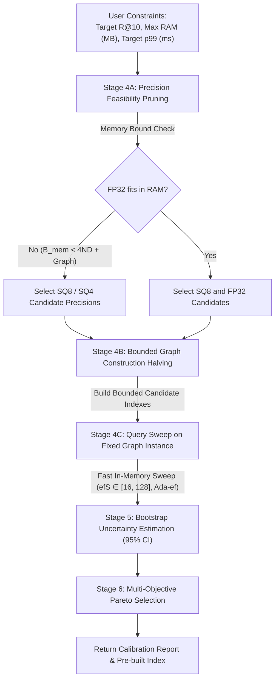

# AdaptiveVec — Automatic Resource-Constrained Index Calibration (Phase 3 Design)

## 1. Executive Summary

Vector search indexes in production are subject to hard operational constraints:
1. **Memory Budget ($B_{mem}$)**: Physical RAM allocated to the index container.
2. **Target Accuracy ($R_{target}$)**: Minimum acceptable Recall@$K$ on production query workloads.
3. **Tail Latency ($L_{p99}$)**: Maximum acceptable 99th-percentile query latency.
4. **Calibration Budget ($T_{calib}$)**: Time permitted to discover optimal parameters.

Existing indexing libraries (e.g., standard HNSW, FAISS, hnswlib) require manual tuning across high-dimensional hyperparameter grids ($(M, efConstruction, efSearch, \text{quantization})$), often requiring hours of exhaustive trial-and-error and redundant index builds. Furthermore, naïve grid searches repeatedly rebuild the entire proximity graph from scratch for every parameter combination, wasting computation and violating calibration time budgets.

Phase 3 introduces **AdaptiveVec Hierarchical Auto-Calibration**: a principled, resource-budgeted optimization engine that automatically discovers the Pareto-optimal index configuration. By decoupling construction-time structural parameters from query-time traversal parameters on immutable graph instances, the calibrator achieves an order-of-magnitude reduction in calibration duration while guaranteeing statistical confidence on recall estimates.

---

## 2. Mathematical Formulation

Let $\mathcal{X} = \{x_1, \dots, x_N\} \subset \mathbb{R}^D$ denote the base vector corpus, and $\mathcal{Q}_{val} = \{q_1, \dots, q_m\}$ denote a set of validation queries with exact ground truth nearest neighbors $\mathcal{G}(q)$.

### 2.1 Optimization Objective

We formulate resource-constrained calibration as a constrained multi-objective optimization problem:

$$\max_{\theta \in \Theta} \quad \text{Throughput}(\theta) = \frac{|\mathcal{Q}_{val}|}{\sum_{q \in \mathcal{Q}_{val}} \text{latency}(q; \theta)}$$

Subject to:
1. **Recall Constraint**:
   $$\widehat{\text{Recall@}}K(\theta) \ge R_{target}$$
2. **Memory Constraint**:
   $$\text{RAM}_{measured}(\theta) \le B_{mem}$$
3. **Tail Latency Constraint**:
   $$p_{99}\left(\{\text{latency}(q; \theta)\}_{q \in \mathcal{Q}_{val}}\right) \le L_{p99}$$
4. **Calibration Duration Constraint**:
   $$T_{elapsed} \le T_{calib}$$

Where the hyperparameter tuple $\theta$ is partitioned into construction parameters and search parameters:
$$\theta = (\theta_{build}, \theta_{search}) = \Big( (M, efConstruction, \mathcal{P}), (efSearch, ada\_ef) \Big)$$
with precision $\mathcal{P} \in \{\text{FP32}, \text{SQ8}, \text{SQ4}\}$.

---

## 3. Hierarchical Three-Stage Optimization Pipeline

Direct Cartesian-product grid search over $\Theta$ requires $\mathcal{O}(|\mathcal{M}| \times |efC| \times |\mathcal{P}| \times |efS| \times |ada\_ef|)$ full index builds. To prevent catastrophic calibration overhead, AdaptiveVec executes a hierarchical 3-stage optimization:



### Stage 4A: Precision Feasibility & Budget Pruning
Before constructing any graph, the engine analytically computes the theoretical lower bound on index memory:

$$\text{RAM}_{min}(\mathcal{P}) = N \times \text{sizeof}(\mathcal{P}) \cdot D + N \times (2 M_{min} \times \text{sizeof}(\text{tableint}) + \text{sizeof}(\text{NodeMetadata}))$$

1. If $B_{mem} < \text{RAM}_{min}(\text{SQ4})$: The calibrator immediately flags **Memory Infeasibility** and reports the theoretical minimum requirement, avoiding wasted computation.
2. If $\text{RAM}_{min}(\text{SQ8}) \le B_{mem} < \text{RAM}_{min}(\text{FP32})$: FP32 is pruned from the search space; candidate precisions are restricted to $\{\text{SQ8}, \text{SQ4}\}$.
3. If $B_{mem} \ge \text{RAM}_{min}(\text{FP32})$: Both SQ8 and FP32 are admitted. In accordance with Phase 2.1 findings, Uniform SQ8 is prioritized as the default baseline due to its $4\times$ memory reduction with negligible recall loss ($<0.5\%$).

### Stage 4B: Bounded Graph Construction Candidate Selection
Rather than arbitrary random sampling, Stage 4B evaluates a bounded candidate ladder of structural connectivity:
- Candidate 1 (Fast/Lean): $M=12, efConstruction=40$
- Candidate 2 (Balanced Default): $M=16, efConstruction=64$
- Candidate 3 (High-Density): $M=24, efConstruction=100$

Each candidate is built on the corpus using multi-threaded batch insertion (`#pragma omp parallel`). Memory allocation is tracked with `.shrink_to_fit()` across all resident pools.

### Stage 4C: Query-Time Search Sweep on Immutable Graph Instances
Once a candidate graph is built, its graph topology and vector pools remain **strictly immutable**. Traversal parameters:
$$efSearch \in \{16, 24, 32, 48, 64, 96, 128, 192\}$$
$$ada\_ef \in \{\text{false}, \text{true}\}$$
are swept entirely in memory across validation queries. Because no graph rebuilding occurs, each search trial takes only milliseconds, allowing the calibrator to evaluate dozens of operating points within seconds.

---

## 4. Statistically Defensible Recall Estimation

Point estimates of Recall@$K$ computed on a small validation set $\mathcal{Q}_{val}$ are subject to sampling variance. Reporting a single empirical mean $\bar{R}$ risks over-promising retrieval fidelity on unseen production queries.

### 4.1 Non-Parametric Bootstrap Confidence Intervals
For each evaluated trial, let $r_i \in [0, 1]$ denote the Recall@$K$ for query $q_i \in \mathcal{Q}_{val}$.
We perform non-parametric bootstrap resampling:
1. Resample with replacement $B = 1,000$ synthetic query cohorts $\{\tilde{r}_1^{(b)}, \dots, \tilde{r}_m^{(b)}\}$, $b \in \{1, \dots, B\}$.
2. Compute the bootstrap mean for each cohort:
   $$\bar{r}^{(b)} = \frac{1}{m} \sum_{i=1}^m \tilde{r}_i^{(b)}$$
3. Compute the empirical $95\%$ confidence interval $[CI_{lower}, CI_{upper}]$:
   $$CI_{lower} = \text{Percentile}_{2.5\%}\left(\{\bar{r}^{(b)}\}\right), \quad CI_{upper} = \text{Percentile}_{97.5\%}\left(\{\bar{r}^{(b)}\}\right)$$

### 4.2 Conservative Feasibility Gate
A configuration is marked recall-feasible if and only if:
$$\bar{R} \ge R_{target}$$
The calibrator outputs both $\bar{R}$ and $[CI_{lower}, CI_{upper}]$ in the report. If $CI_{lower} < R_{target}$ despite $\bar{R} \ge R_{target}$, the report explicitly warns of statistical uncertainty on out-of-sample workloads.

---

## 5. Multi-Objective Selection & Pareto Optimization

Let $\mathcal{T} = \{\tau_1, \dots, \tau_T\}$ be the set of all evaluated trials.

### 5.1 Pareto Dominance Definition
Trial $\tau_a$ dominates $\tau_b$ ($\tau_a \succ \tau_b$) if and only if:
$$\text{Recall}(\tau_a) \ge \text{Recall}(\tau_b) \quad \land \quad \text{QPS}(\tau_a) \ge \text{QPS}(\tau_b) \quad \land \quad \text{RAM}(\tau_a) \le \text{RAM}(\tau_b) \quad \land \quad p_{99}(\tau_a) \le p_{99}(\tau_b)$$
with at least one strict inequality.

The calibrator maintains the non-dominated Pareto frontier $\mathcal{P}^* \subseteq \mathcal{T}$ and exports it as part of the trial report.

### 5.2 Objective Ranking
Subject to hard feasibility gates, the winning configuration is selected according to the user's `OptimizationGoal`:
- **`MaxThroughput`** (Default): $\arg\max_{\tau \in \text{Feasible}} \text{QPS}(\tau)$
- **`MinMemory`**: $\arg\min_{\tau \in \text{Feasible}} \text{RAM}(\tau)$ (ties broken by QPS)
- **`MinLatency`**: $\arg\min_{\tau \in \text{Feasible}} p_{99}(\tau)$
- **`MaxRecall`**: $\arg\max_{\tau \in \text{Feasible}} \text{Recall}(\tau)$

If no configuration satisfies all constraints simultaneously, the engine identifies the closest trade-off on the Pareto frontier, records the violated constraints explicitly (e.g., `Memory exceeded by 14%`, `Target recall 0.98 not reachable; best achieved 0.956 [0.951, 0.960]`), and returns a fully transparent diagnostic report.

---

## 6. Comparison with Prior Art

| Capability | FAISS Autotune | DiskANN Auto-tune | Bayesian ANNS Optimizers | AdaptiveVec Hierarchical Calibrator |
|---|---|---|---|---|
| **Memory Budget Pruning** | Manual inspection | None | Soft penalty | **Hard Stage 4A analytical pruning** |
| **Index Rebuild Policy** | Rebuilds on parameter changes | Fixed single index | Rebuilds per iteration | **Decoupled: sweeps query parameters on fixed graph** |
| **Quantization Integration** | Pre-selected index factory string | Fixed compression | Heuristic | **Integrated FP32 / Uniform SQ8 / SQ4 selection** |
| **Statistical Rigor** | Point estimate only | Point estimate only | Gaussian process variance | **Non-parametric 95% Bootstrap Confidence Intervals** |
| **Infeasibility Reporting** | Silent fallback | Fails build | Sub-optimal convergence | **Explicit constraint violation diagnosis** |
| **Zero-Redundant Build** | Returns parameter string only | Returns parameter file | Returns dictionary | **Returns pre-built, ready-to-search index directly** |

---

## 7. Native C++ & Python API Architecture

### 7.1 C++ Integration
```cpp
#include "auto_calibrator.hpp"

using namespace adaptivevec;

CalibrationConstraints constraints;
constraints.target_recall = 0.95f;
constraints.max_memory_mb = 128.0;
constraints.target_p99_latency_ms = 4.0f;
constraints.optimization_goal = OptimizationGoal::MaxThroughput;

std::unique_ptr<AdaptiveHNSWIndex> index = nullptr;
CalibrationReport report = AutoCalibrator::calibrate(
    base_vectors, n_base, dim, SpaceType::L2,
    query_vectors, n_queries, ground_truth,
    constraints, index, "SIFT-100K"
);

std::cout << report.summary() << std::endl;
// Index is already constructed and calibrated; immediately ready for search:
auto results = index->search(query, k=10, report.selected_config.ef_search);
```

### 7.2 Python Integration (`adaptivevec`)
```python
from adaptivevec import AdaptiveVec

# Initialize index with optimization constraints
index = AdaptiveVec(
    dimension=384,
    target_recall=0.95,
    memory_budget_mb=128.0,
    target_p99_latency_ms=4.0,
    auto_optimize=True
)

# Run hierarchical calibration (Phase A/B/C + Bootstrap CI)
report = index.calibrate(
    vectors=base_vectors,
    calibration_queries=query_vectors,
    ground_truth=ground_truth
)

print(report.summary())

# Search using calibrated parameters:
results = index.search(query_vectors[0], k=10)
```
