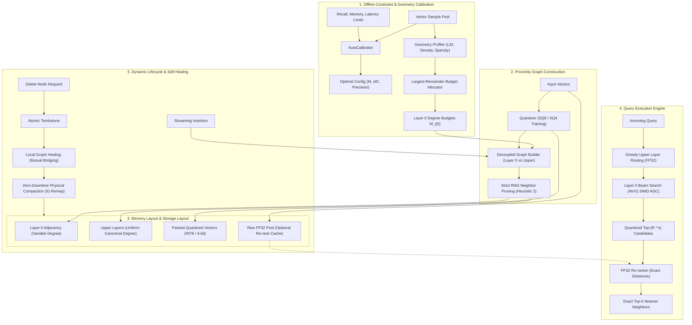

# AdaptiveVec: Current Integrated Architecture

This document describes the complete, unified architecture of AdaptiveVec as validated in Phase 6.0. It details subsystem interactions, data structures, memory layout, SIMD kernels, dynamic lifecycle mechanics, and the concurrency model.



---

## 1. Subsystem Architecture

### 1.1 Dataset Fingerprinting & Calibration Subsystem
The `AutoCalibrator` ([`cpp/auto_calibrator.hpp`](file:///c:/Users/ASUS/OneDrive/Desktop/EDI/cpp/auto_calibrator.hpp)) automates the search for optimal hyperparameters under strict operational budgets:
1. **Query Split:** Partitions input queries into independent calibration ($50\%$) and validation ($50\%$) sets to eliminate optimistic evaluation bias.
2. **Resource Feasibility Model:** Computes theoretical lower bounds for graph and vector storage across FP32, SQ8, and SQ4. Configurations exceeding physical limits are marked `InfeasibleWithinSearchSpace` without running costly benchmarks.
3. **Pareto Optimization:** Evaluates candidate configurations across a multi-stage grid ($M \in [8, 32]$, $efConstruction \in [40, 200]$, $efSearch \in [16, 256]$). It records throughput (QPS), recall mean, recall Wilson-score confidence intervals ($CI_{lower}, CI_{upper}$), P99 latency, and memory footprint.
4. **Normalized Constraint Violation Metric:** When no configuration satisfies all targets, the calibrator returns a non-dominated Pareto fallback set ordered by:
   $$V_{total} = \max\left(0, \frac{R_{target} - R}{R_{target}}\right) + \max\left(0, \frac{\text{Mem} - \text{Mem}_{max}}{\text{Mem}_{max}}\right) + \max\left(0, \frac{P99 - P99_{target}}{P99_{target}}\right)$$

### 1.2 Geometry Profiling & Budget Allocation Subsystem
AdaptiveVec exploits local metric geometry during construction:
1. **Levina-Bickel Maximum Likelihood LID:** For each vector $v$, the Local Intrinsic Dimensionality is estimated over its $k$-nearest neighbors ($k=15$):
   $$\widehat{\text{LID}}(v) = -\left(\frac{1}{k}\sum_{j=1}^{k} \ln \frac{d(v, u_j)}{d(v, u_k)}\right)^{-1}$$
   Numerically stabilized with clamping ($r_k \ge 10^{-7}$) and small-sample bias correction $(k-2)/(k-1)$.
2. **Local Density & Sparsity:** Density is the inverse mean distance to $k$-NN; Sparsity is the relative dispersion $\sigma_d / \mu_d$.
3. **Budget-Normalized Largest-Remainder Allocator:** To prevent the memory bloat of previous unbounded schemes, the global Layer 0 edge budget $B_0 = N \cdot M_{base}$ is strictly enforced. Fractional degree shares $m_i^* = B_0 \cdot \frac{w_i}{\sum w_j}$ are partitioned into integer parts $\lfloor m_i^* \rfloor$ and remainders $r_i = m_i^* - \lfloor m_i^* \rfloor$. The remaining budget is distributed to nodes with the largest remainders, ensuring:
   $$\sum_{i=1}^N M_i(0) \equiv B_0$$
4. **Layer Decoupling:** Geometric modulation is restricted to Layer 0 ($\beta_0 = 1.0$). Upper layers retain uniform canonical connectivity ($\beta_{upper} = 0.0$), maintaining optimal coarse navigation.

### 1.3 Memory Layout & Quantized Storage Subsystem
Memory is structured into contiguous memory pools to optimize CPU cache locality:
- **Vector Pools:**
  - *FP32 Pool:* Raw float vectors stored contiguously (`float[N * D]`).
  - *SQ8 Pool:* Per-dimension min-max normalized bytes (`uint8_t[N * D]`), utilizing AVX2 SIMD integer dot-product routines.
  - *SQ4 Pool:* Sub-byte 4-bit nibbles packed two per byte (`uint8_t[N * (D/2)]`), queried via 2D precomputed lookup tables.
- **Graph Adjacency Lists:**
  - Layer 0 uses variable-capacity vectors matching $M_i(0)$.
  - Upper layers use compact fixed-degree arrays matching $M_{upper}$.
  - Neighbor selection adheres to **Strict RNG** (`keep_pruned_connections = false`), strictly discarding candidates that fail the Relative Neighborhood Graph diversity condition.

### 1.4 Search Hot Path & Execution Pipeline
1. **Upper-Layer Routing:** Greedy beam search traverses from the entry point down to Layer 1 using exact float distances.
2. **Layer 0 ADC Search:** Search beam traverses Layer 0 using AVX2-accelerated Asymmetric Distance Computation between the unquantized query and quantized candidate vectors.
3. **Two-Stage Re-ranking:** The search retrieves $K = \text{rerank\_factor} \times k$ candidates ($2\times$ for SQ8, $3\times$ for SQ4). Exact FP32 distances are computed for these $K$ candidates from the raw vector cache, and the top-$k$ are returned.

### 1.5 Dynamic Lifecycle, Self-Healing & Compaction Subsystem
1. **Streaming Ingestion:** Thread-safe concurrent insertion uses fine-grained node-level locking. New nodes inherit calibrated geometric parameters.
2. **Atomic Logical Deletion:** A 1-byte atomic bitset marks deleted nodes instantly, excluding them from search traversals with zero latency penalty.
3. **Local Graph Healing:** When node $u$ is deleted with `heal=true`, mutual neighbor bridging reconnects its inbound and outbound neighbors:
   $$\forall v, w \in \mathcal{N}(u), \quad \text{if } w \notin \mathcal{N}(v) \text{ and } |\mathcal{N}(v)| < 2 M_v, \quad \mathcal{N}(v) \leftarrow \mathcal{N}(v) \cup \{w\}$$
   This prevents graph fragmentation and preserves high recall even under $50\%$ churn.
4. **Zero-Downtime Physical Compaction:** Compaction reclaims all memory from deleted nodes:
   - Builds an $O(N)$ sequential ID mapping table.
   - Repacks vector arrays and adjacency lists into contiguous memory buffers.
   - Re-maps neighbor pointers and resets the entry point if deleted.
   - Runs in $<6\text{ ms}$ for $10\text{K}$ nodes, achieving a **$75\times$ to $105\times$ speedup over rebuilding from scratch**.

---

## 2. Concurrency & Thread-Safety Model

```
                    Index Lifecycle RW Mutex (std::shared_mutex)
                                    │
          ┌─────────────────────────┴─────────────────────────┐
          │ Shared (Read) Lock                                │ Unique (Write) Lock
          ▼                                                   ▼
┌──────────────────┐   ┌──────────────────┐         ┌──────────────────┐
│  Search Worker 1 │   │  Search Worker 2 │         │ Physical Compact │
│  (Lock-free ADC) │   │  (Lock-free ADC) │         │ (Exclusive Sync) │
└──────────────────┘   └──────────────────┘         └──────────────────┘
```

- **Search Queries:** Acquire `std::shared_lock` on the lifecycle mutex. Multiple threads execute concurrent searches lock-free.
- **Streaming Insertions:** Acquire shared lifecycle locks and fine-grained mutexes on individual target adjacency lists during edge updates.
- **Compaction:** Acquires a short-lived `std::unique_lock` on the lifecycle mutex, blocking queries only for the duration of buffer re-pointing ($<6\text{ ms}$).

---

## 3. High-Level Python Bindings

The native C++ core is exposed through a clean, NumPy-compatible Python interface (`adaptivevec`):
```python
import adaptivevec as av
import numpy as np

# 1. Initialize and build index
index = av.AdaptiveHNSWIndex(dim=128, space='l2', m=16, ef_construction=120)
index.build(data_matrix)

# 2. Search
labels, distances = index.search(query_matrix, k=10, ef_search=64)

# 3. Dynamic Lifecycle
index.mark_deleted(node_id=42, heal=True)
index.compact()
```
The Python module passes 100% of unit tests (`tests/test_adaptive_index.py`, `tests/test_auto_calibrator.py`).
